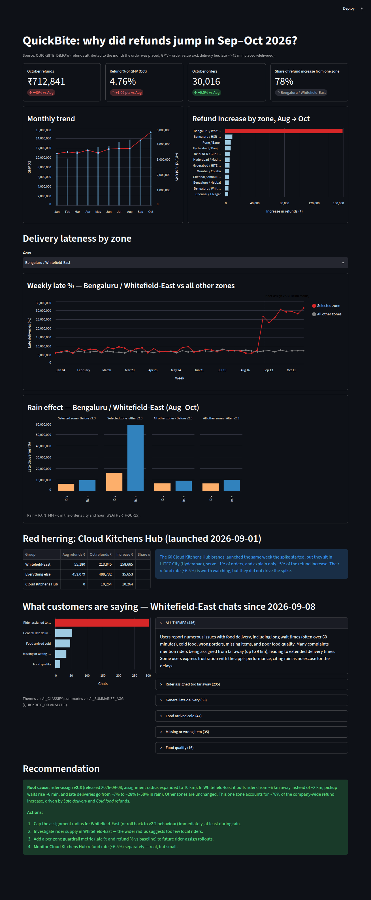

# QuickBite COO Dashboard — Why Did Refunds Jump in Sep–Oct 2026?

An interactive **root-cause analysis dashboard** built with **Streamlit** on top of **Snowflake**, using **Snowflake Cortex AI functions** to turn raw customer support chats into structured themes and summaries.

The dashboard answers one executive question for the COO of *QuickBite* (a food-delivery company): **why did refunds jump ~40% between August and October 2026?** It walks the reader from the headline numbers down to the root cause, rules out a tempting but wrong explanation, backs up the finding with what customers actually said, and ends with concrete recommended actions.



> A full-page PDF export of the UI is also available: [`Ui.pdf`](Ui.pdf)

---

## Table of Contents

- [Key Findings](#key-findings)
- [Tech Stack](#tech-stack)
- [Architecture](#architecture)
- [Data Model](#data-model)
- [Dashboard Walkthrough](#dashboard-walkthrough)
- [How It Was Implemented](#how-it-was-implemented)
- [Metric Definitions](#metric-definitions)
- [Getting Started](#getting-started)
- [Deploying to Streamlit in Snowflake](#deploying-to-streamlit-in-snowflake)
- [Troubleshooting](#troubleshooting)
- [Use Cases](#use-cases)
- [Extending the Project](#extending-the-project)
- [Project Structure](#project-structure)

---

## Key Findings

| Metric (Oct 2026) | Value | vs. Aug 2026 |
|---|---|---|
| Refunds | ₹712,841 | **+40%** |
| Refund % of GMV | 4.76% | **+1.06 pts** |
| Orders | 30,016 | +9.5% |
| Share of refund increase from one zone | **78%** | Bengaluru / Whitefield-East |

**Root cause:** the **rider-assign v2.3** release on **2026-09-08** expanded the rider assignment radius to 10 km. In **Whitefield-East (Bengaluru)**, riders are now pulled from ~6 km away instead of ~2 km, pickup waits rise by ~6 minutes, and late deliveries jump from **~7% to ~28%** (**~58% when it rains**). Other zones are unaffected.

**Red herring ruled out:** the 60 *Cloud Kitchens Hub* brands launched on 2026-09-01, the same week the spike began. However, they serve only ~1% of orders and explain only ~5% of the increase.

**Customer voice confirms it:** of 446 Whitefield-East support chats since the release, **295 (66%)** are classified by AI as *"Rider assigned too far away"*.

---

## Tech Stack

| Layer | Technology | Purpose |
|---|---|---|
| Data warehouse | **Snowflake** | Stores raw orders, refunds, weather, restaurants, zones and support chats |
| AI / LLM | **Snowflake Cortex AI** — `AI_CLASSIFY`, `AI_SUMMARIZE_AGG`, `AI_COUNT_TOKENS` | Classifies free-text support chats into complaint themes and summarizes them, directly in SQL |
| App framework | **Streamlit** (≥ 1.56, tested on 1.66) | Interactive web UI, layout, widgets, caching |
| Connectivity | **`st.connection("snowflake")`** + **Snowflake Connector for Python** | Managed, cached connection to Snowflake |
| Visualization | **Altair** (Vega-Lite) | Layered bar/line charts, dual axes, annotations, faceted charts |
| Data handling | **pandas** | Post-query shaping (sorting, deltas, shares) |
| Language | **Python** ≥ 3.11 (tested on 3.13) | |
| Packaging | **uv** + `pyproject.toml` / `uv.lock` | Reproducible dependency management |
| Query language | **Snowflake SQL** | All aggregation pushed down to the warehouse |

---

## Architecture

```
┌──────────────────────────── Snowflake ────────────────────────────┐
│                                                                   │
│  QUICKBITE_DB.RAW                       QUICKBITE_DB.ANALYTIC     │
│  ├── ORDERS                             ├── WFE_SUPPORT_CHAT_     │
│  ├── REFUNDS                            │   THEMES     (AI_CLASSIFY)
│  ├── CITIES_ZONES        ── Cortex AI ─▶└── WFE_SUPPORT_CHAT_     │
│  ├── RESTAURANTS            (one-time       SUMMARIES  (AI_SUMMARIZE_AGG)
│  ├── WEATHER_HOURLY          batch job)                           │
│  └── SUPPORT_CHATS ─────────────┘                                 │
│                                                                   │
│        ▲  Aggregated SQL (warehouse COMPUTE_WH, role SYSADMIN)    │
└────────┼──────────────────────────────────────────────────────────┘
         │  st.connection("snowflake")  — results cached 1 hour
┌────────┴──────────── Streamlit app (streamlit_app.py) ────────────┐
│  load_*() functions ─▶ pandas DataFrames ─▶ Altair charts / KPIs  │
└───────────────────────────────────────────────────────────────────┘
         │
      Browser (http://localhost:8501)
```

Design principles:

- **Push compute to Snowflake.** Every heavy aggregation (joins, `GROUP BY`, `COUNT_IF`, conditional sums) runs in SQL; only small, pre-aggregated result sets reach Python.
- **Run AI once, read many times.** The Cortex AI classification and summarization run as a one-time batch into `ANALYTIC` tables, so the dashboard never re-runs LLM calls on page load. This keeps it fast and avoids repeated AI credit cost.
- **Cache everything.** All loaders use `@st.cache_data(ttl=3600)`, and `conn.query(..., ttl=3600)` adds a second layer of caching.
- **Parameterized SQL.** User-selected values (the zone ID) are passed as bind parameters (`?`), never string-formatted into SQL.

---

## Data Model

### `QUICKBITE_DB.RAW`

| Table | Key columns used | Description |
|---|---|---|
| `ORDERS` | `ORDER_ID`, `ZONE_ID`, `CITY`, `RESTAURANT_ID`, `PLACED_AT`, `ACCEPTED_AT`, `PICKED_UP_AT`, `DELIVERED_AT`, `ORDER_VALUE_INR`, `RIDER_ASSIGN_DISTANCE_KM` | One row per order |
| `REFUNDS` | `ORDER_ID`, `REFUND_AMOUNT_INR` | Refunds; an order can have several |
| `CITIES_ZONES` | `ZONE_ID`, `CITY`, `ZONE_NAME` | Delivery zones |
| `RESTAURANTS` | `RESTAURANT_ID`, `CLUSTER` | Restaurant master, including the *Cloud Kitchens Hub* cluster |
| `WEATHER_HOURLY` | `CITY`, `HOUR_TS`, `RAIN_MM` | Hourly weather per city |
| `SUPPORT_CHATS` | `CHAT_ID`, `ORDER_ID`, `CUSTOMER_ID`, `CHAT_AT`, `MESSAGE` | Free-text customer support messages |

### `QUICKBITE_DB.ANALYTIC` (AI-derived)

| Table | Built with | Description |
|---|---|---|
| `WFE_SUPPORT_CHAT_THEMES` | `AI_CLASSIFY` | Each Whitefield-East chat since 2026-09-08, labelled with one complaint theme |
| `WFE_SUPPORT_CHAT_SUMMARIES` | `AI_SUMMARIZE_AGG` | One natural-language summary per theme, plus an `ALL THEMES` summary |

---

## Dashboard Walkthrough

The page is laid out as a top-down narrative: **what happened → where → why → what it isn't → what customers say → what to do.**

1. **KPI cards:** October refunds, refund % of GMV, order volume (each with a delta vs. August), and the share of the increase coming from the single worst zone.
2. **Monthly trend:** GMV bars with a refund-% line on an independent second axis, January to October 2026.
3. **Refund increase by zone (Aug → Oct):** the top 12 zones by absolute increase, with the outlier zone highlighted in red.
4. **Delivery lateness by zone (interactive):** a zone **selectbox** drives:
   - **Weekly late %** for the selected zone vs. all other zones, with a dashed annotation at the **rider-assign v2.3** release date.
   - **Rain effect:** late % split by *Dry / Rain* × *Before / After v2.3* × *Selected zone / All others*, with tooltips for average assignment distance and pickup wait.
5. **Red herring: Cloud Kitchens Hub:** a table comparing the new brands' contribution to the increase, with an explanation of why they're not the cause.
6. **What customers are saying:** AI-classified chat themes (bar chart) plus expandable AI-generated summaries per theme.
7. **Recommendation:** the root cause and four prioritized actions.

---

## How It Was Implemented

### 1. Exploration and hypothesis testing (SQL in Snowflake)

The investigation started with month-level refunds and GMV, then sliced the increase by zone, restaurant cluster, refund reason, weather and time. Two candidate causes coincided with the spike:

- **Cloud Kitchens Hub launch** (2026-09-01): tested by isolating its restaurants' refunds. It was small and geographically separate, so it was **rejected**.
- **Rider-assign v2.3 release** (2026-09-08): weekly late % in Whitefield-East stepped up exactly at the release, while assignment distance and pickup wait rose and rain amplified the effect. This was **confirmed**.

### 2. Turning unstructured chats into evidence (Cortex AI)

Support chats for the affected zone were classified with `AI_CLASSIFY`, using labelled categories with descriptions to improve accuracy:

```sql
CREATE OR REPLACE TABLE QUICKBITE_DB.ANALYTIC.WFE_SUPPORT_CHAT_THEMES AS
SELECT c.CHAT_ID, c.ORDER_ID, c.CUSTOMER_ID, c.CHAT_AT, c.MESSAGE,
  AI_CLASSIFY(c.MESSAGE, [
    {'label':'Rider assigned too far away','description':'Rider was far away, took long to reach restaurant, or assignment distance complaint'},
    {'label':'Food arrived cold',          'description':'Food was cold, lukewarm or not hot on arrival'},
    {'label':'General late delivery',      'description':'Order was late or delayed without mentioning rider distance or cold food'},
    {'label':'Missing or wrong item',      'description':'An item was missing or a different item was delivered'},
    {'label':'Food quality',               'description':'Taste, freshness, spillage or quality of the food itself'}],
    {'task_description':'Classify a food-delivery customer support chat message by its main complaint theme'}
  ):labels[0]::STRING AS THEME
FROM QUICKBITE_DB.RAW.SUPPORT_CHATS c
JOIN QUICKBITE_DB.RAW.ORDERS o USING (ORDER_ID)
WHERE o.ZONE_ID = 1 AND c.CHAT_AT >= '2026-09-08';
```

Each theme was then summarized with `AI_SUMMARIZE_AGG`:

```sql
CREATE OR REPLACE TABLE QUICKBITE_DB.ANALYTIC.WFE_SUPPORT_CHAT_SUMMARIES AS
SELECT 'ALL THEMES' AS THEME, COUNT(*) AS N, AI_SUMMARIZE_AGG(MESSAGE) AS SUMMARY
FROM QUICKBITE_DB.ANALYTIC.WFE_SUPPORT_CHAT_THEMES
UNION ALL
SELECT THEME, COUNT(*), AI_SUMMARIZE_AGG(MESSAGE)
FROM QUICKBITE_DB.ANALYTIC.WFE_SUPPORT_CHAT_THEMES
GROUP BY THEME;
```

Before running these, `AI_COUNT_TOKENS` was used to estimate the token volume and therefore the cost.

### 3. Building the Streamlit app

- **Connection:** `st.connection("snowflake", role=..., warehouse=..., database=..., schema=...)` with error handling that shows a friendly `st.error` and stops the script.
- **Loaders:** one cached function per visual (`load_monthly`, `load_zone_increase`, `load_weekly_late`, `load_rain`, `load_cloud_kitchens`, `load_chat_themes`). A shared CTE (`REFUNDS_PER_ORDER`) pre-aggregates refunds per order so that orders with several refunds aren't double-counted in joins.
- **Derived metrics in pandas:** Aug→Oct deltas, each zone's share of the total increase, and the headline KPI text.
- **Charts in Altair:** dual-axis layered charts (`resolve_scale(y="independent")`), conditional colour highlighting (`alt.condition`), a release-date rule plus text annotation, and faceted bar charts (`column=`).
- **Layout:** `layout="wide"`, `st.columns`, bordered `st.container`s, `st.metric(border=True)`, `st.expander`, and `st.info` / `st.success` callouts.

---

## Metric Definitions

| Metric | Definition |
|---|---|
| **GMV** | `SUM(ORDER_VALUE_INR)`, the order value **excluding the delivery fee** |
| **Refunds** | `SUM(REFUND_AMOUNT_INR)`, **attributed to the month the order was placed** (not the month the refund was issued) |
| **Refund % of GMV** | `100 × refunds / GMV` |
| **Late delivery** | More than **45 minutes** (2,700 s) from `PLACED_AT` to `DELIVERED_AT` |
| **Pickup wait** | Minutes from `ACCEPTED_AT` to `PICKED_UP_AT` |
| **Rain** | `RAIN_MM > 0` in the order's city during the hour it was placed |
| **Before / After v2.3** | `PLACED_AT` before / on-or-after `2026-09-08` |

---

## Getting Started

### Prerequisites

- Python **3.11+**
- [uv](https://docs.astral.sh/uv/) (recommended) or `pip`
- A Snowflake account containing `QUICKBITE_DB.RAW` and `QUICKBITE_DB.ANALYTIC`
- A role with `USAGE` on warehouse `COMPUTE_WH` and `SELECT` on both schemas (the app uses `SYSADMIN` by default)
- Cortex AI functions enabled in your region, if you want to rebuild the `ANALYTIC` tables

### 1. Clone and install

```bash
git clone https://github.com/Vinaykumarreddy467/quickbite-coo-dashboard.git
cd quickbite-coo-dashboard

# with uv
uv sync

# or with pip
python -m venv .venv && source .venv/bin/activate
pip install "streamlit[snowflake]>=1.56.0"
```

### 2. Configure the Snowflake connection

Add a connection to `~/.snowflake/connections.toml`:

```toml
default_connection_name = "my_conn"

[my_conn]
account       = "<your-account-identifier>"
user          = "<your-user>"
authenticator = "externalbrowser"   # or OAUTH_AUTHORIZATION_CODE, SNOWFLAKE_JWT, etc.
role          = "SYSADMIN"
warehouse     = "COMPUTE_WH"
```

> **Never commit credentials.** Keep `connections.toml` and `.streamlit/secrets.toml` out of Git.

### 3. Run

```bash
uv run streamlit run streamlit_app.py
# or, inside the activated venv:
streamlit run streamlit_app.py
```

Open http://localhost:8501. With browser-based authentication, a Snowflake login window opens on the first query.

---

## Deploying to Streamlit in Snowflake

The app only uses `st.connection("snowflake")`, so it can also run natively inside Snowflake:

1. In Snowsight, go to **Projects → Streamlit → + Streamlit App**.
2. Choose the database/schema and warehouse `COMPUTE_WH`.
3. Paste in `streamlit_app.py`, and add `altair` and `pandas` as packages if needed.
4. Grant `USAGE` on the Streamlit app to the COO's role so they can view it without a local setup.

Alternatively, use the Snowflake CLI: `snow streamlit deploy`.

---

## Troubleshooting

| Error | Cause | Fix |
|---|---|---|
| `Default connection with name 'default' cannot be found, known ones are ['XYZ']` | No default connection is set | Add `default_connection_name = "XYZ"` to `connections.toml`, or run with `SNOWFLAKE_DEFAULT_CONNECTION_NAME=XYZ streamlit run streamlit_app.py` |
| `Port 8501 is not available` | Another Streamlit instance is already running | Stop it, or use `--server.port 8502` |
| `Object does not exist or not authorized` | Missing grants, or wrong account/role | Grant `SELECT` on `QUICKBITE_DB.RAW` / `ANALYTIC` to the role, or change `role=` in `get_snowflake_connection()` |
| Stale numbers after the data changes | Results are cached for 1 hour | Choose **⋮ → Clear cache** in the app, or restart it |

---

## Use Cases

**Direct use**
- **Executive incident review:** a single page a COO can read in two minutes to understand a cost spike, its cause and the fix.
- **Post-release impact analysis:** measuring how a product or algorithm release (here, the rider-assignment radius) affected operations zone by zone.
- **Ruling out false causes:** explicitly testing and dismissing coincident events, such as a new-brand launch.

**Adjacent applications of the same pattern**
- **Refund and fraud monitoring:** track refund % of GMV by zone, restaurant, reason or customer segment.
- **Delivery SLA monitoring:** late-delivery % by zone, hour, weather and rider supply.
- **Weather-aware operations planning:** quantify how rain affects delivery times and pre-position riders.
- **Voice-of-customer analytics:** classify and summarize support chats, reviews or tickets with Cortex AI, entirely in SQL.
- **Release guardrails / canary analysis:** compare a treated segment against all others around a release date.
- **Restaurant and partner performance:** refund and lateness scorecards per restaurant cluster.
- **Template for other domains:** e-commerce returns, ride-hailing cancellations, logistics SLA breaches, telecom complaints — any situation where *"metric X spiked; why?"*

---

## Extending the Project

- **Date-range and city filters** in a sidebar, instead of the hard-coded Aug vs. Oct comparison.
- **Automated anomaly detection** with Snowflake ML `ANOMALY_DETECTION` on daily refund % per zone.
- **Alerts:** a Snowflake **Alert** or **Task** that emails or posts to Slack when a zone's late % or refund % exceeds its baseline.
- **Incremental AI enrichment:** use a **Stream + Task** or a **Dynamic Table** so new support chats are classified automatically.
- **Conversational Q&A:** add a **Semantic View** + **Cortex Analyst**, so the COO can ask follow-up questions in plain English.
- **Refund-reason drill-down:** break the increase down by refund reason (*Late delivery*, *Cold food*, ...).
- **Cost/impact simulator:** estimate refunds saved by capping the assignment radius at various distances.
- **Tests and CI:** unit tests with `streamlit.testing.v1.AppTest`, plus GitHub Actions for linting.
- **Dockerfile** for container-based deployment.

---

## Project Structure

```
quickbite_coo_dashboard/
├── streamlit_app.py   # The dashboard: connection, cached SQL loaders, charts, narrative
├── pyproject.toml     # Project metadata and dependencies
├── uv.lock            # Locked dependency versions (uv)
├── Ui.png             # Full-page screenshot of the dashboard
├── Ui.pdf             # Full-page PDF export of the dashboard
└── README.md
```

---

## Author

Built by **Vinay Kumar Reddy**. Feel free to open an issue or a pull request.
